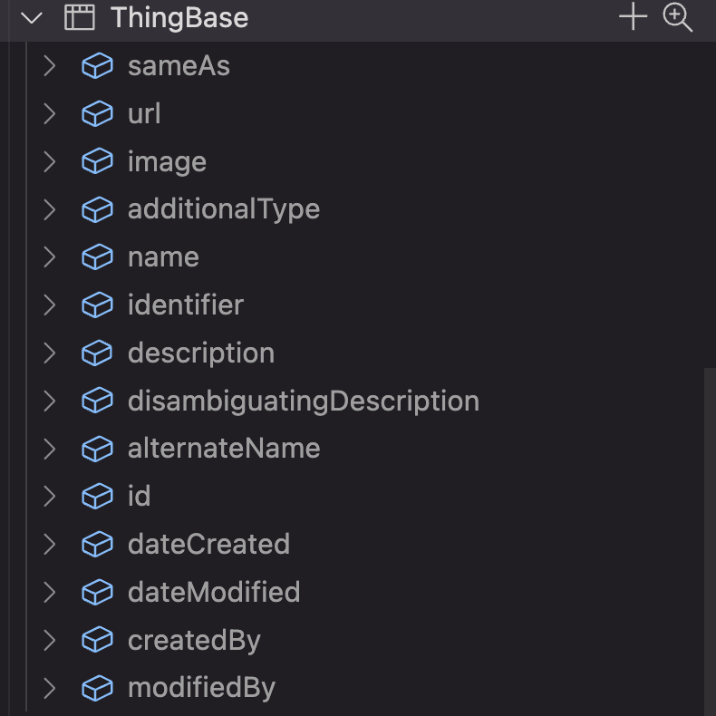
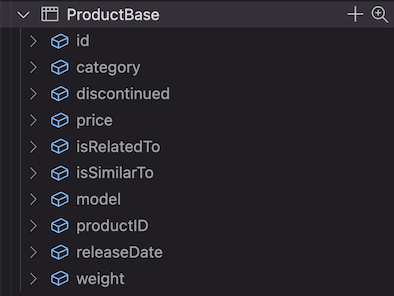
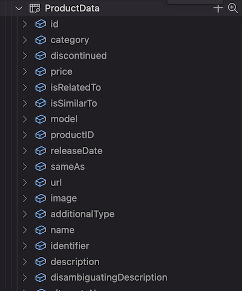
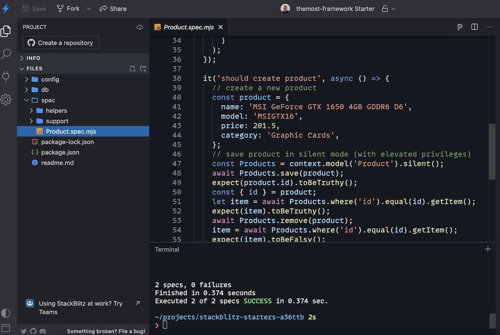

# Create a data model

In `@themost/data`, a model schema describes a model's fields, their types, and other model properties. Model definitions are JSON files stored in the application's `config/models` directory.

## Define a model

Create a file named after the model. For example, define a `Product` model in `config/models/Product.json`:

```json
{
    "$schema": "https://themost-framework.github.io/themost/models/2018/2/schema.json",
    "name": "Product",
    "version": "2.1",
    "inherits": "Thing"
}
```

The `name` property identifies the model, `version` tracks its schema version, and `inherits` names its base model. Here, `Product` inherits the common fields defined by the built-in `Thing` model.

Include `"$schema": "https://themost-framework.github.io/themost/models/2018/2/schema.json"` to enable schema validation and editor support.

The following is the model definition for `Thing`:

```json
{
    "$schema": "https://themost-framework.github.io/themost/models/2018/2/schema.json",
    "@id": "http://schema.org/Thing",
    "name": "Thing",
    "description": "The most generic type of item.",
    "title": "Thing",
    "abstract": false,
    "sealed": false,
    "hidden": true,
    "version": "2.0",
    "fields": [{
            "@id": "http://schema.org/sameAs",
            "name": "sameAs",
            "title": "sameAs",
            "description": "URL of a reference Web page that unambiguously indicates the item's identity. E.g. the URL of the item's Wikipedia page, Wikidata entry, or official website.",
            "type": "URL"
        },
        {
            "@id": "http://schema.org/url",
            "name": "url",
            "title": "url",
            "description": "URL of the item.",
            "type": "URL"
        },
        {
            "@id": "http://schema.org/image",
            "name": "image",
            "title": "image",
            "description": "An image of the item. This can be a <a class=\"localLink\" href=\"http://schema.org/URL\">URL</a> or a fully described <a class=\"localLink\" href=\"http://schema.org/ImageObject\">ImageObject</a>.",
            "type": "Text"
        },
        {
            "@id": "http://schema.org/additionalType",
            "name": "additionalType",
            "title": "additionalType",
            "description": "An additional type for the item, typically used for adding more specific types from external vocabularies in microdata syntax. This is a relationship between something and a class that the thing is in. In RDFa syntax, it is better to use the native RDFa syntax - the 'typeof' attribute - for multiple types. Schema.org tools may have only weaker understanding of extra types, in particular those defined externally.",
            "type": "Text",
            "value": "javascript:return this.model.name;",
            "readonly": true
        },
        {
            "@id": "http://schema.org/name",
            "name": "name",
            "title": "name",
            "description": "The name of the item.",
            "type": "Text"
        },
        {
            "@id": "http://schema.org/identifier",
            "name": "identifier",
            "title": "identifier",
            "description": "The identifier property represents any kind of identifier for any kind of <a class=\"localLink\" href=\"http://schema.org/Thing\">Thing</a>, such as ISBNs, GTIN codes, UUIDs etc. Schema.org provides dedicated properties for representing many of these, either as textual strings or as URL (URI) links. See <a href=\"/docs/datamodel.html#identifierBg\">background notes</a> for more details.",
            "type": "Text"
        },
        {
            "@id": "http://schema.org/description",
            "name": "description",
            "title": "description",
            "description": "A description of the item.",
            "type": "Text"
        },
        {
            "@id": "http://schema.org/disambiguatingDescription",
            "name": "disambiguatingDescription",
            "title": "disambiguatingDescription",
            "description": "A sub property of description. A short description of the item used to disambiguate from other, similar items. Information from other properties (in particular, name) may be necessary for the description to be useful for disambiguation.",
            "type": "Text"
        },
        {
            "@id": "http://schema.org/alternateName",
            "name": "alternateName",
            "title": "alternateName",
            "description": "An alias for the item.",
            "type": "Text"
        },
        {
            "@id": "https://themost.io/schemas/id",
            "name": "id",
            "title": "ID",
            "description": "The identifier of the item.",
            "type": "Counter",
            "primary": true
        },
        {
            "@id": "https://themost.io/schemas/dateCreated",
            "name": "dateCreated",
            "title": "dateCreated",
            "description": "The date on which this item was created.",
            "type": "DateTime",
            "readonly": true,
            "value": "javascript:return new Date();"
        },
        {
            "@id": "https://themost.io/schemas/dateModified",
            "name": "dateModified",
            "title": "dateModified",
            "description": "The date on which this item was most recently modified.",
            "type": "DateTime",
            "readonly": true,
            "value": "javascript:return (new Date());",
            "calculation": "javascript:return (new Date());"
        },
        {
            "@id": "https://themost.io/schemas/createdBy",
            "name": "createdBy",
            "title": "createdBy",
            "description": "Created by user.",
            "type": "User",
            "readonly": true,
            "value": "javascript:return this.user();"
        },
        {
            "@id": "https://themost.io/schemas/modifiedBy",
            "name": "modifiedBy",
            "title": "modifiedBy",
            "description": "Last modified by user.",
            "type": "User",
            "readonly": true,
            "value": "javascript:return this.user();",
            "calculation": "javascript:return this.user();"
        }
    ]
}
```

The `fields` property is an array of field definitions. Each field has a `name` and a `type`; optional properties describe values and behavior. For example, `value` sets a default, `readonly` marks a field as read-only, `primary` identifies a key field, and `calculation` defines a calculated value.

For more information about the concepts represented by `Thing`, see the [schema.org Thing documentation](https://schema.org/Thing).

## Database tables and views

The model's stored fields are represented by columns in its database table. For example, the `Thing` model is stored in `ThingBase`, where `id` is the primary key. The `dateCreated` and `dateModified` fields record when a row was created and last modified; `createdBy` and `modifiedBy` identify the users responsible for those changes.



Each model has a corresponding database table for storing its data. By default, the table name is the model name with the `Base` suffix; for example, `Product` uses `ProductBase`. Set the model's `source` property to choose a different table name.



Because `Product` inherits from `Thing`, `ProductBase` has a foreign key to `ThingBase`. When the model version is increased, the `@themost/data` migration engine can apply schema changes, including adding, removing, or updating fields.

`@themost/data` also creates a database view for each model. By default, the view name is the model name with the `Data` suffix, such as `ProductData`. Set the model's `view` property to choose a different name.

The view is used to query model data and joins the model's table with the tables of its inherited models. For `Product`, `ProductData` joins `ProductBase` and `ThingBase`.




## Define fields

Each model has a set of fields. A field can use a built-in type such as `Text`, `Date`, or `Number`, or use another model's name as its type to reference that model.

The following definition adds fields to `Product`, which inherits the fields from `Thing`:

```json
{
    "$schema": "https://themost-framework.github.io/themost/models/2018/2/schema.json",
    "name": "Product",
    "version": "2.1",
    "inherits": "Thing",
    "fields": [
        {
            "name": "category",
            "title": "Category",
            "description": "A category related to this product.",
            "type": "Text"
        },
        {
            "name": "discontinued",
            "title": "Discontinued",
            "description": "Indicates whether this product is discontinued or not.",
            "type": "Boolean"
        },
        {
            "name": "price",
            "title": "Price",
            "description": "The price of the product.",
            "type": "Number"
        },
        {
            "name": "isRelatedTo",
            "title": "Is Related to",
            "description": "A pointer to another, somehow related product (or multiple products).",
            "type": "Product"
        },
        {
            "name": "isSimilarTo",
            "title": "Is Similar to",
            "description": "A pointer to another, functionally similar product (or multiple products).",
            "type": "Product"
        },
        {
            "name": "model",
            "title": "Model",
            "description": "The model of the product. Use with the URL of a ProductModel or a textual representation of the model identifier. The URL of the ProductModel can be from an external source. It is recommended to additionally provide strong product identifiers via the gtin8/gtin13/gtin14 and mpn properties.",
            "type": "Text"
        },
        {
            "name": "productID",
            "title": "Product ID",
            "description": "The product identifier, such as ISBN. For example: <code>&lt;meta itemprop='productID' content='isbn:123-456-789'/&gt;</code>.",
            "type": "Text"
        },
        {
            "name": "releaseDate",
            "title": "Release Date",
            "description": "The release date of a product or product model. This can be used to distinguish the exact variant of a product.",
            "type": "Date"
        }
    ]
}
```

See [this StackBlitz example](https://stackblitz.com/edit/stackblitz-starters-a36ttb) for a working project that defines a model like `Product` with `@themost/data`.



## Summary

Define models as JSON files in `config/models`, use the `$schema` property for editor support, and describe model data with fields and types. Inherited models map to related database tables, while the generated data view provides a queryable representation of the model and its inherited fields.
